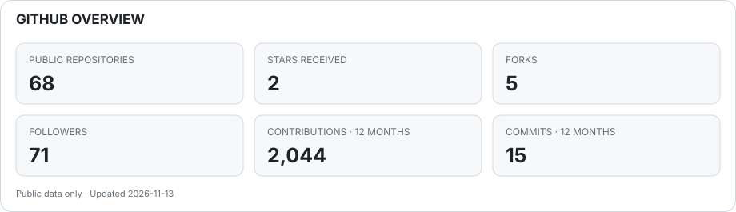
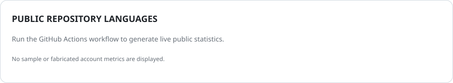

# FATIH GÜNAYDIN

### FULL STACK SOFTWARE DEVELOPER

**Building scalable software. Engineering meaningful solutions.**

[GitHub](https://github.com/FatihG34)

---

## About Me

I'm a **Full Stack Software Developer** with 5+ years of professional experience designing, developing, and deploying software solutions.

I work across frontend development, backend engineering, database design, API development, and production delivery. My focus is on turning complex business requirements into reliable, maintainable applications — from architecture and implementation to deployment.

- **Full-stack engineering:** modern web applications and end-to-end product delivery.
- **Backend engineering:** APIs, business logic, integrations, and data processing services.
- **Business platforms:** e-commerce, production workflows, order management, and SaaS applications.
- **Engineering practices:** clean code, SOLID principles, maintainability, and performance.
- **AI-assisted development:** using AI tools and agent-based workflows thoughtfully in the engineering lifecycle.

## Engineering Focus

| Backend & APIs | Frontend | Data & Infrastructure |
|---|---|---|
| Java · Spring Boot | Angular · React | PostgreSQL · MongoDB |
| Node.js · Python | Next.js · TypeScript | Redis · MySQL |
| Django · FastAPI · REST APIs | JavaScript · Tailwind CSS | Docker · Linux · Nginx |
| Integrations · Background jobs | Responsive interfaces | GitHub Actions · CI/CD |

## Technology Stack

**Languages & frameworks**  
Java · Spring Boot · Node.js · Python · FastAPI · Django · Angular · React · Next.js · TypeScript · JavaScript

**Databases & infrastructure**  
PostgreSQL · MongoDB · MySQL · Redis · Docker · Linux · Nginx · Bash · Git · GitHub Actions

<!-- PROFILE_STATS:START -->
## GitHub Overview

<!-- <picture>
  <source media="(prefers-color-scheme: dark)" srcset="./assets/statistics/overview-dark.svg">
  <source media="(prefers-color-scheme: light)" srcset="./assets/statistics/overview-light.svg">
  
</picture> -->

<picture>
  <source media="(prefers-color-scheme: dark)" srcset="./assets/statistics/languages-dark.svg">
  <source media="(prefers-color-scheme: light)" srcset="./assets/statistics/languages-light.svg">
  
</picture>
<!-- PROFILE_STATS:END -->

## What I Build

### Business Applications & SaaS

Role-based business applications, multi-tenant platform concepts, operational dashboards, and workflow-oriented systems.

### E-commerce & Integrations

Product and variant management, inventory synchronization, order workflows, marketplace integrations, and automation services.

### Backend & Data Processing

Maintainable APIs, domain logic, image/file processing workflows, database models, and background services.

## Engineering Principles

- **Clarity over cleverness:** code should be easy to understand and maintain.
- **Separation of concerns:** clear boundaries between responsibilities.
- **Design for change:** modular systems that can evolve with business needs.
- **Measure before optimizing:** performance decisions based on evidence.
- **Security by design:** least privilege, validation, and explicit authorization.

## Let's Connect

I'm interested in full-stack engineering roles, remote and international opportunities, freelance engagements, and collaborations on meaningful software products.

- GitHub: [@FatihG34](https://github.com/FatihG34)
- LinkedIn: [Fatih Günaydın](https://www.linkedin.com/in/fatih-gunaydin/)

**Let's turn ideas into reliable software.**

Designed and maintained by Fatih Günaydın.

